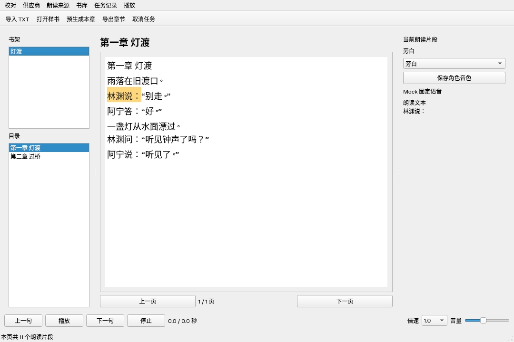

# 小说朗读室

将中文 TXT 小说导入桌面书架，按角色给对白配音，在原文中跳句、改音和续听，也可以把整章导出为 WAV。支持 Python 3.12 和 PySide6 6.9.3，核心包可以离线启动。

## 第一次使用

Windows x64 与 Ubuntu 24.04 x86_64 的原生预览包可从同一发布页下载，每个包附有 SHA-256 校验文件。 [下载桌面预览版](https://github.com/lz0755/novel-tts-reader/releases/tag/desktop-0.1.0-preview)

1. 解压完整的发行包。Ubuntu x86_64 运行 `./NovelTTSReader`，Windows x64 便携预览包双击 `NovelTTSReader.exe`。
2. 点击「打开样书」，选第一章后点击「播放」。右侧显示当前说话人、朗读文本及音频来源。样书有两章、三种固定普通话音色，未收录的文本和音色组合使用标为 Mock 的测试音。
3. 点击「预生成本章」，完成后点击「导出章节」，输入新文件夹名。输出包含 `chapter.wav` 和逐段 `manifest.json`。样章可直接试听。 [第一章音频](docs/evidence/demo-chapter/chapter.wav) · [导出清单](docs/evidence/demo-chapter/manifest.json)
4. 导入自己的 TXT 时可以预览编码和章节。在正文选择范围后，通过校对菜单编辑角色、声音、风格或纠音。重开书架会恢复到上次的原句。 [安装、书库备份与恢复](docs/installation.md)



## 朗读来源

| 来源 | 使用方式与本次验证范围 |
|---|---|
| 离线样书 | 从输入、固定语音、播放器、高亮到导出走完整流程，已在断网 Ubuntu 包上运行。音频及 SHA-256 随包提供。 |
| 云端标注 | 在「供应商」选择 OpenAI、DeepSeek 或兼容端点，独立设置模型、协议和输出格式。通过后可以分章或整书标注。已测回环协议、预算、重试与网络故障，真实账号待验。 |
| Qwen 云端语音 | 选择与账号地域一致的工作区端点、模型和实际 voice ID，允许本章上传后合成。下次仅使用缓存也可重听。已有音频协议和归一化测试，真实服务与费用待验。 |
| Qwen 本地双模型 | 在「朗读来源」选择推理用的 Python 和 `runtime.json`，再加载 0.6B 或 1.7B。两档已在 Windows 11 的 RTX 4060 Laptop GPU（8 GB）上合成中文样音。 [本地 Qwen3-TTS 使用指南](docs/local-runtime.md) |

云端标注和语音分别授权。程序按模型实际支持的能力发送指令。费用未知会保留此状态。真实本地语音需要独立模型、驱动与运行时。 [供应商阶段记录](docs/evidence/M4.md) · [云端配音记录](docs/evidence/M5.md)

## 从源码启动

```sh
uv sync --locked --python 3.12
uv run --no-sync python -m novel_tts --mode mock
uv run --no-sync python -m novel_tts --self-test
uv run --no-sync pytest -q
```

自检在临时目录导入样书并导出整章。可用 `--data-dir` 指定独立书库，无显示设备的 CI 设 `QT_QPA_PLATFORM=offscreen`。Windows 和 Ubuntu 的原生构建命令、系统库及运行目录要求见安装说明。 [安装与构建](docs/installation.md)

## 版本与验收

M0 至 M7 各有独立提交、标签和 GitHub Milestone。主分支在 Ubuntu 24.04 和 Windows Server 2022 上各通过 47 项自动化测试。预览版的 52 项验收中，26 项通过、3 项待测、23 项受外部条件阻塞。Ubuntu 24.04.5 发行包在普通账户、断网、只读安装目录下完成自检。Windows x64 便携预览在 Wine 9 下自检。原生 Windows 11、实体声卡、真实云服务和目标 GPU 仍待验收。 [GitHub 双平台测试](https://github.com/lz0755/novel-tts-reader/actions/runs/44915411279) · [逐项验收](docs/ACCEPTANCE.md) · [交付状态与阶段标签](docs/STATUS.md) · [样本清单](fixtures/manifest.json)
