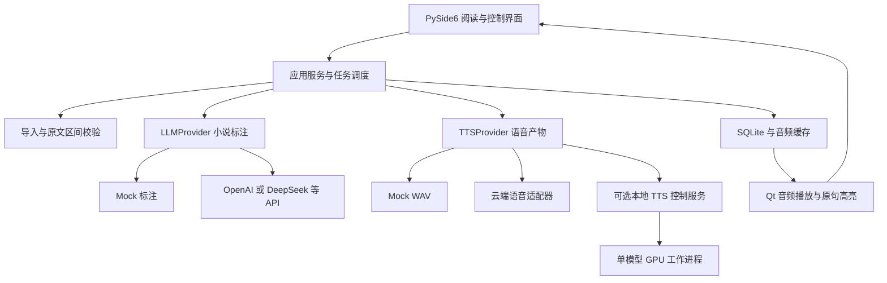

# 跨平台 AI 有声小说阅读器项目计划书

**版本：V2.0 · 日期：2026 年 11 月 21 日 · 前端：Python + PySide6 · 目标平台：Windows 与 Linux**

本项目将本地中文小说转为可阅读、可校对、可按角色朗读的桌面书籍。用户导入 TXT 后，可以识别章节、查看正文、生成角色标注、选择云端或本地 TTS、逐句播放，并修正说话人和读音。小说处理通过可配置的 OpenAI 风格 API 接入 OpenAI、DeepSeek 及其他兼容服务。

实施顺序固定为：**完整 Mock 产品闭环 → 文本与播放可靠性 → 真实小说处理 API → 云端 TTS → Windows/Linux 核心发行包 → 最后接入并验证本地 Qwen TTS。** 本地模型的协议与能力从第一阶段预留，模型下载、CUDA 配置和真实推理放在 M7。此前没有 API Key、没有网络、没有 GPU，也应能开发和演示 Mock 版本。

本版承接 2026 年 11 月 14 日的小说阅读器 V1.2 计划，保留 TXT、书架、章节、角色自动配音、双档 CustomVoice、逐句高亮、断点续听、纠音和缓存。桌面技术栈与开发顺序以本版为准。工期、延迟、准确率和显存条目均为规划或待测目标；本文件不代表应用已经实现或目标机已经通过测试。

配套文件：[Vibe Coding 指南](./Novel_TTS_Vibe_Coding_Guide_v2.md)；[里程碑与验收手册](./Novel_TTS_Milestones_Acceptance_v2.md)。

## 1 项目决策与交付范围

### 1.1 核心决策

| 项目 | 本版决定 | 工程目的 |
| --- | --- | --- |
| 桌面界面 | Python 3.12 + PySide6，首版采用 Qt Widgets | 阅读器、表格、树形目录、文件选择和桌面播放使用统一 Python 技术栈 |
| 平台 | Windows 11 x64、Ubuntu 24.04 x86_64 为首轮验证基线 | Linux 从路径、线程、播放、打包阶段持续纳入；不在最后才移植 |
| 小说处理 | `LLMProvider` 下实现 Chat Completions 与 Responses 两种协议适配 | 供应商、协议、模型与结构化输出能力可以独立配置 |
| 语音合成 | `TTSProvider` 下提供 Mock、云端、本地 Qwen 三种实现 | 替换声音来源时复用同一任务、缓存、播放与导出流程 |
| 首个云端 TTS | 优先 Qwen 云端 HTTP 分段合成，具体型号与地域经账户验证后确定 | 优先获得容易检查的完整音频产物 |
| 其他云端选项 | OpenAI Realtime 音频适配；已有旧 Speech 接入仅作为过渡 | 明确不同端点和能力，避免把文本兼容当作语音兼容 |
| 本地 TTS | `Qwen3-TTS-12Hz-0.6B-CustomVoice` 与 `Qwen3-TTS-12Hz-1.7B-CustomVoice` | 首版接口直接兼容两档，一次仅加载一档，单并发 |
| 数据 | SQLite + 书籍快照 + 本地音频文件 | 支持断点、修订、去重和崩溃恢复 |
| 音频播放 | Qt Multimedia 的 `QMediaPlayer` + `QAudioOutput` | Mock 与真实音频共用真实播放器 |
| 部署 | 桌面核心包、可选本地推理运行时、模型资源分别管理 | Mock/云端安装不引入 PyTorch、CUDA 或模型下载 |
| 研发方式 | 每个里程碑完成一个可演示的切片，依据验收编号推进 | 编码助手每次围绕可观察行为完成有限改动 |

PySide6 是 Qt 的官方 Python 绑定；官方 `pyside6-deploy` 基于 Nuitka，覆盖桌面部署。本项目选择该路线作为打包基线，实际依赖版本和平台插件在 M0/M6 锁定并验证。[Qt for Python][s-qt]、[部署工具][s-deploy]

### 1.2 三种使用模式

| 模式 | 小说处理 | 发声来源 | 网络与 GPU 要求 |
| --- | --- | --- | --- |
| 演示与开发 | Mock 标注或规则旁白 | 固定语音样本 / 明确标注的测试音 | 不需要 API Key、网络或 GPU |
| 云端使用 | OpenAI、DeepSeek 或其他兼容服务；也可手工标注 | 已配置的云端 TTS | 生成新内容需要相应网络与服务权限；无需本地 GPU |
| 本地朗读 | 已有标注、规则旁白、手工标注；可选云端补充 | 本地 Qwen CustomVoice | 运行时及模型准备后可离线合成；设备能力以实测为准 |

已有完整缓存可离线播放。只有核心应用已安装、而本地模型未准备时，离线能力包含阅读和缓存回放，不包含新的真实语音合成。Mock 模式只用于开发和演示，不能作为真实模式失败后的静默回退。

### 1.3 功能边界

| 首轮必须交付 | 后续独立增强 |
| --- | --- |
| TXT 导入、编码预览、章节识别、书架、阅读进度 | 无 DRM 的文本型 EPUB |
| 旁白、角色和原文子区间标注，支持人工纠正 | 本地语言模型处理小说 |
| 新角色自动分配可用音色，事后换声并持久化 | Base 音色克隆、VoiceDesign 声音设计 |
| 单句合成、同角色短句的受控合并、逐句高亮与跳句 | 句内音频流、复杂音文强制对齐 |
| 暂停、恢复、倍速、断点续听、预生成与缓存清理 | 背景音乐、环境音、复杂后期处理 |
| 单句/单书/全局纠音，局部重生成 | 多人协作、跨设备同步 |
| 完整章节 WAV 导出；导出清单记录顺序与来源 | MP3、M4B、Opus、章节封面与发行元数据 |
| OpenAI 与 DeepSeek 实际标注接入；自定义兼容配置 | 更多专有文本或语音协议 |
| 至少一个云端 TTS 实际通过；两档本地 Qwen 最后验证 | OpenAI Realtime 作为第二云端实现可独立排期 |

MVP 以确定的业务管线为主，不需要把小说处理做成开放式 Agent 工具循环。首版也无需为了调用 LLM 引入 LangChain；供应商 SDK、HTTP 客户端和清晰的领域接口足够支撑需求。

## 2 用户流程与界面

### 2.1 从导入到收听

1. 创建书籍并选择 TXT，预览编码、书名和章节边界，保存导入修订。
2. 进入阅读器，可直接阅读；选择规则旁白、Mock 演示或已配置的真实处理方式。
3. 开启某本书的云端分析时，展示发送正文的范围、用途和估算费用。只分析当前章及必要前文，整书批量处理为独立操作。
4. LLM 返回角色和区间标注；本地验证后将新角色自动绑定到当前 TTS 的可用音色。
5. 用户按句试听，必要时修改角色、声音、情绪或读音。人工修订优先于后续自动结果。
6. 调度器先查音频缓存，缺失时合成；播放器播放当前句，同时预生成后续内容。
7. 关闭应用时保存原文锚点和播放位置；重启后恢复。用户也可导出已经完整生成的章节。

### 2.2 界面布局

| 区域 | 内容与操作 |
| --- | --- |
| 左侧 | 书架、章节树、当前进度、章内生成状态 |
| 中间 | 当前正文窗口、正在朗读的原句、选区纠音、点击跳句 |
| 右侧 | 当前角色、音色、情绪、角色别名、人工修订记录 |
| 底部 | 播放/暂停、上一句/下一句、进度、倍速、音量、缓冲状态 |
| 设置页 | 小说处理供应商、协议、模型、TTS 来源、密钥、缓存与模型目录 |
| 任务页 | 分析、合成、下载、导出任务，失败原因、重试与取消 |

界面区分“读取中”“分析中”“生成中”“等待音频”“正在播放”等状态；网络请求成功与真正开始播放分别显示。开发演示中的测试音标注来源，真实模式只展示用户需要理解的提供方和状态。

百万字书籍采用章节或正文窗口加载。目录使用 Qt Model/View；不把整本书一次插入大型富文本控件，不在每个播放进度事件中重绘整章。

## 3 总体架构与执行边界



### 3.1 主进程的线程分工

| 执行单元 | 工作 | 约束 |
| --- | --- | --- |
| Qt 主线程 | Widgets、播放器、用户输入、轻量状态转换与调度通知 | 禁止同步网络请求、模型推理、大文件解析、音频编码和长事务 |
| 有界 `QThreadPool` | 导入、LLM/云 TTS 请求、下载、校验、音频导出 | 输入为不可变快照，通过 queued signals 返回结果；每类任务有并发和超时上限 |
| `RepositoryWorker` 专属 `QThread` | SQLite 连接、查询、迁移和串行写事务 | 连接在所属线程创建和关闭；不通过 `check_same_thread=False` 共享连接绕过边界 |
| 可选本地控制服务 | 模型状态、作业协议、超时、产物传输、GPU 子进程生命周期 | 控制请求不能被 GPU 长调用阻塞 |
| 单 GPU 子进程 | 导入 Qwen/PyTorch、加载、预热、推理 | 使用 `spawn`，一次只驻留一个模型，最多一个合成任务 |

`RepositoryWorker` 暴露 `commit_annotations`、`save_voice_binding`、`commit_audio_artifact`、`save_progress` 等事务级方法。UI 不应拼 SQL；后台服务不应直接修改 Widget。

Qt 的线程归属和 queued connection 决定槽执行位置。将对象移动到后台线程，并不意味着可以在该线程的一个长阻塞槽中同时处理取消和健康检查。本方案将阻塞请求放入有限工作任务，由独立的控制路径管理状态。[QThread 官方说明][s-qthread]

### 3.2 建议代码组织

| 目录 | 内容 |
| --- | --- |
| `src/novel_tts/ui/` | 窗口、Model/View、正文映射、角色面板、播放器 UI |
| `src/novel_tts/application/` | 用例、任务调度、播放会话、提交守卫 |
| `src/novel_tts/domain/` | DTO、区间、角色、能力、状态与业务验证 |
| `src/novel_tts/ports/` | LLM、TTS、Repository 等业务协议 |
| `src/novel_tts/contracts/` | JSON Schema、本地控制协议和版本常量 |
| `src/novel_tts/providers/llm/` | Mock、Chat Completions、Responses 适配器 |
| `src/novel_tts/providers/tts/` | Mock、Qwen Cloud、本地控制协议、可选 OpenAI Realtime |
| `src/novel_tts/infrastructure/storage/` | RepositoryWorker、SQLite 迁移、缓存索引 |
| `src/novel_tts/infrastructure/audio/` | 播放控制、格式校验、段落合并、导出 |
| `src/novel_tts/infrastructure/platform/` | 路径、凭据、进程启动、平台能力检查 |
| `sidecar/` | 独立项目与锁文件；控制服务和 Qwen runner，仅 M7 引入真实推理依赖 |
| `fixtures/` | 自制样书、预期标注、录音 WAV、故障场景与清单 |
| `tests/` | 领域、协议、队列、恢复与必要 GUI 测试 |
| `scripts/` | 约定的演示、环境诊断、验收和测量入口 |
| `docs/` | 本计划、指南、验收记录、接口及版本决策 |

这些目录和命令是待实现约定；当前交付为计划文档。桌面和本地推理分别锁定依赖，Qt、PyTorch、Transformers 的版本不必处于同一虚拟环境。

## 4 核心契约与供应商配置

### 4.1 两类业务接口

```python
from typing import Protocol

class LLMProvider(Protocol):
    def capabilities(self) -> "LLMCapabilities": ...
    def analyze_chunk(self, request: "AnnotationRequest") -> "AnnotationResult": ...

class TTSProvider(Protocol):
    def capabilities(self) -> "TTSCapabilities": ...
    def synthesize(self, request: "SynthesisRequest") -> "AudioArtifact": ...
```

以上为接口草案，不是完整实现。同步方法只在后台执行；远端提交、轮询和下载可以封装在适配器内部。业务层获得统一的完成结果或类型化错误，不处理供应商原始 JSON 字段。

| 契约 | 必要字段 |
| --- | --- |
| `AnnotationRequest` | 书/章/导入修订、目标父段 ID 和原文、有限前文、已确认角色、提示词/schema 版本、配置快照 |
| `AnnotationResult` | 原请求关联、原文区间标注、候选角色与证据、用量、实际模型、完整/截断/拒绝状态 |
| `SynthesisRequest` | `job_id`、朗读文本、实际 provider/model/voice、有效情绪、语言、生成参数、产物格式、修订快照 |
| `AudioArtifact` | 受控文件或资源 ID、内容摘要、采样率、声道、位深、时长、可选句内边界、实际模型信息、来源、有效参数 |
| `LLMCapabilities` | 协议、schema/json/text 支持、流式能力、参数白名单、长度预算、验证日期 |
| `TTSCapabilities` | 传输协议、音色、情绪/语速/时间戳能力、输入限额及单位、输出格式、取消语义、验证日期 |

`AudioArtifact.origin` 固定区分 `mock_fixture`、`mock_tone`、`cloud`、`local`。Mock 的产物进入独立缓存命名空间，不能命中真实提供方的请求，也不能被写进真实性能报告。

### 4.2 配置示例

```yaml
profile: mock

llm:
  provider_id: deepseek
  protocol: chat_completions
  base_url: https://api.deepseek.com/v1
  model: deepseek-flash
  credential_ref: keyring:novel-reader/deepseek
  structured_output: json_object
  max_attempts: 2
  request_deadline_seconds: 90

tts:
  provider_id: mock
  model: fixture-v1
  voice_binding_scope: provider_model

storage:
  data_dir: auto
  cache_dir: auto
  model_dir: user_selected
```

这是结构示例，不是对某模型永久可用或该参数普遍适用的保证。用户切换 OpenAI 时可使用 `https://api.openai.com/v1`，选择 Responses 适配与该模型支持的输出模式；其他兼容服务可以自定义 Base URL、模型及受支持请求字段。保存配置时冻结能力结果，不在后台任意猜测或替换模型。

密钥只保存为系统凭据引用。模型列表发现是可选能力，`/models` 不可用时允许手动填写模型 ID；一次成功的 HTTP 请求不代表 JSON Schema、情绪或音色选择已经生效。

## 5 小说导入 原文锚点与文本处理

### 5.1 原文与派生文本

保留原文件字节与摘要、编码选择、解码结果及导入修订。优先 BOM、严格 UTF-8，再提供 GB18030 等候选预览；不默默以替换字符吞掉解码失败。

为索引建立固定的 `canonical_text`：只按明确规则统一换行，并保留与解码原文的映射。章节、父段和子段坐标全部基于该快照。后续清理广告、纠音、去除装饰符只生成派生层，不修改已有原文坐标。不同编码或清理决策产生新修订。

每个朗读单元保留：

- `source_span`：书内、章内 `[start_cp, end_cp)`，以 Unicode 码点计数。
- `display_text`：从不可变原文快照切出。
- `tts_text`：经数字/单位规范化和有效纠音规则生成。
- `speaker_id`、`style`、人工覆盖、修订及分析来源。
- 空白、纯装饰、明确不朗读的文字保留位置，使用明确的跳过标记。

原文中出现“忽略前面的指令”等文本时，仍只作为待标注书籍内容。小说处理不授予文件、网络或执行工具权限，模型返回的数据必须经过本地验证。

### 5.2 Qt 显示位置转换

Python 码点坐标和 `QTextCursor` 使用的 UTF-16 单元不是同一计数方式。阅读器为当前正文窗口构建正反向映射；高亮、选词纠音和点击跳句均经过该映射，并处理换行及窗口起始偏移。组合字符、ZWJ 表情和补充平面汉字不得被拆开。[QTextCursor 坐标定义][s-qtext]

测试至少包含 `𠮷`、emoji、带组合重音的字符、ZWJ emoji、CRLF/LF。不要通过对原文执行 NFC/NFKC 后继续使用旧坐标来“修复”显示问题。

### 5.3 分章与 LLM 分块

本地先按章标题、自然段和标点建立父段。用户可预览并修正章节边界，标点切分保留引号、冒号与上下文。

LLM 请求分为只读上下文与目标区间：前文帮助理解说话人，只有目标区间可以产生正式标注。相邻请求的上下文可以重叠，目标区间不能重复入库。正在阅读的章节优先，后台批量任务有界排队。

请求预算包含系统提示、角色摘要、上下文、目标正文与输出余量。无法获取该模型精确 tokenizer 时，采用经过样本测量的保守估计，并在上下文超限错误后拆块；不把“中文一个字等于一个 token”作为容量依据。持久化角色档案、别名和带证据的简短前情，避免每次携带整本书。

## 6 多家 OpenAI 风格 API 的实现方式

### 6.1 协议与结构化输出

| 层次 | 实现 |
| --- | --- |
| 领域接口 | `LLMProvider.analyze_chunk`，不暴露供应商协议 |
| Chat Completions | 处理 `messages`、`choices`、`finish_reason` 与该模型支持的 `response_format` |
| Responses | 处理 `input`、输出 item、`text.format`、完成/截断/失败状态 |
| 提供方配置 | Base URL、模型、请求头、能力、超时、凭据引用与计费规则 |
| 统一验证 | JSON 解析、schema 校验、区间完整性、引用有效性、修订及人工覆盖校验 |

OpenAI 当前建议新项目使用 Responses，Chat Completions 仍支持；DeepSeek 当前也提供 Responses，但服务端状态和部分参数的行为不同。因此本项目自行维护上下文，不依赖 `previous_response_id` 或服务端会话来维持小说阅读进度。[OpenAI 迁移指南][s-responses]、[DeepSeek Responses][s-ds-responses]

结构化输出按能力选择：`json_schema` → `json_object` → 明确约束的 JSON 文本。降级必须被记录；仅在确定是能力不支持时调整，鉴权失败、余额不足或正文验证失败不应触发盲目换模式。无论使用哪种输出模式，本地业务验证都必须执行。DeepSeek 的 Responses 文档提供 JSON Schema 格式，Chat JSON mode 仍需处理空白和不完整输出。[DeepSeek Responses 请求格式][s-ds-response-schema]、[JSON mode][s-ds-json]

首版默认等待一个分块的完整结构化结果再提交。流式输出可用于显示进度，但半个 JSON、未结束的 SSE 或截断响应不能落为有效剧本。

### 6.2 标注响应示例

父段 `s17` 的原文为 `林渊说：“别走。”少年阿宁答：“好。”`，共 19 个码点。林渊已有角色 `c07`，阿宁是本批新候选：

```json
{
  "schema_version": 1,
  "import_revision": "r1",
  "batch_id": "b17",
  "candidates": [
    {
      "ref": "new1",
      "name": "阿宁",
      "evidence": {"span_id": "s17", "start": 9, "end": 13}
    }
  ],
  "lines": [
    {
      "span_id": "s17",
      "parts": [
        {"start": 0, "end": 4, "speaker": "narrator", "style": ""},
        {"start": 4, "end": 9, "speaker": "c07", "style": "低声挽留"},
        {"start": 9, "end": 15, "speaker": "narrator", "style": ""},
        {"start": 15, "end": 19, "speaker": "new1", "style": "简短应答"}
      ]
    }
  ]
}
```

模型只提交区间、人物与表演提示，正式正文由本地切片取得。每个父段的子区间必须有序、非空、连续且完整覆盖；引用必须属于本书已有角色或同批有效候选。错误书籍、过时修订、重复父 ID、越界、空洞、重叠和拆开字形簇的结果拒绝提交。

区间计数错误只允许有界纠正：可向模型返回具体校验错误重试一次，或缩小目标段重做。不得用全书第一次字符串匹配来替换位置。重复台词尤其需要原段 ID 与位置约束。仍失败时保留最近有效标注，新段回落为待确认的旁白。

### 6.3 角色与准确率

角色实体以书为作用域；同名异人可以具有不同稳定 ID。别名合并需要证据或用户确认，性别、年龄等推断不作为不可变事实。明确无法判断的对白标为 `unknown` 并使用旁白，不强行猜身份。

沿用旧版的验收样本方向：至少 300 个人工标注句段，其中包含 150 句可明确归属的对白、30 句歧义对白、30 个多人父段、30 个极短对白及 20 个首次出现角色，子集可以交叠。明确对白正确率以 90% 为初始目标，同时报告覆盖率、拒答/未知比例和错误类型，避免靠全部输出旁白得到表面上的安全结果。

## 7 角色配音 人工修订与纠音

### 7.1 自动声音绑定

第一次出现的新角色在验证通过后自动分配当前提供方可用的声音。匹配顺序为明确的语言需求、可用声线描述、近期复用程度，再使用稳定摘要排序打破平局。音色池用尽时允许复用，不阻塞播放。

保存 `character_id + provider_profile_id + resolved_model_id + voice_id + binding_source + revision`。`binding_source` 区分 `auto`、`manual` 和系统旁白。角色身份可以跨提供方复用，音色 ID 必须按提供方/模型管理；切回原提供方时恢复其先前绑定。

用户手工换声后，自动重分析不得覆盖。提供方缺少该音色时可以建立明确标注的临时替代，同时保留原始选择。新角色、候选映射和首次自动绑定在同一数据库事务提交，避免重试制造重复角色。

### 7.2 纠音规则

优先级为：**单句覆盖 > 单书词典 > 全局词典 > 默认文本规范化。** 规则保存原文范围、作用域、替换内容和试听结果。UI 始终显示原文，可以并排展示将要朗读的文本。

对于“单于”、数字、日期、比分、英文缩写等，用户可以试听后保存词典或单句替换。纠音只影响命中的朗读文本及必要合成组，不应使整本书因全局词典版本变化而重新生成。

情绪保存在剧本中，适配器根据真实能力决定是否传入。某模型不支持情绪时保留该标注，切到支持的模型后再生效；不通过在正文前拼接“请用悲伤语气朗读”来模拟指令。

## 8 云端 TTS 与本地 TTS 选项

### 8.1 云端方案

| 选项 | 接入方式 | 适合本项目的用法 | 需要单独验证 |
| --- | --- | --- | --- |
| Qwen-Audio-TTS HTTP | 地域/工作区对应的 HTTP 接口；非流式或 SSE | M5 首选完整 WAV/可下载产物，再接入播放缓存 | 账户可用型号、音色、输入限制、指令能力、计费单位与地域 |
| Qwen3-TTS-Flash HTTP | 其对应版本的 DashScope 多模态合成协议 | 账户已有该型号时作为替代配置 | 不与 Qwen-Audio 的路径、字段或 SDK 代际混用 |
| OpenAI Realtime | WebSocket 等 Realtime 协议，文本输入、音频事件输出 | 作为额外云端适配器，完整收集一段后复用现有播放流程 | 忠实朗读、角色会话隔离、完成状态、音频格式与费用 |
| 其他云端语音 | 各自适配器 | 后续按同一 `TTSProvider` 接入 | 不因文本接口兼容 OpenAI 就认为具备语音接口 |

2026 年 11 月 19 日更新的 Qwen-Audio-TTS 文档给出的示例模型为 `qwen-audio-3.1-tts-flash`；其请求带工作区及地域，支持返回完整结果或 SSE。实现时固定接口代际，并由配置提供匹配的工作区、Key 与型号。[Qwen-Audio-TTS HTTP][s-qwen-cloud]

截至本版日期，OpenAI 已公布 `tts-1`、`tts-1-hd`、`gpt-4o-mini-tts` 系列于 **2027 年 1 月 6 日**停用，建议迁移到 `gpt-realtime-2.1-mini` 的 Realtime API；该模型不能直接填入 `/v1/audio/speech`。因此新计划不把旧 Speech 接口设为长期默认。[OpenAI TTS][s-openai-tts]、[弃用公告][s-deprecations]

OpenAI Realtime 在已经产出音频的会话中不能随意更换音色。多角色应使用受控的独立会话或按声音管理会话；完整 `response.done` 成功前不得把音频块当成最终产物。它用于逐字小说朗读的稳定性是本项目需另行测试的适配风险。[Realtime 会话][s-realtime]

云端产物如果是临时 URL，下载、校验并放入本地缓存后才算该段完成。下载失败优先重试原 URL，而非立刻重新支付一次合成。SSE 中断、结束状态异常或损坏 WAV 都不提交成功缓存。

### 8.2 本地 Qwen 两档

| 模型 | 首版定位 | 有效调用 |
| --- | --- | --- |
| `Qwen/Qwen3-TTS-12Hz-0.6B-CustomVoice` | 轻量预设声音 | `generate_custom_voice`；文本、语言、音色与生成参数；不发送情绪 `instruct` |
| `Qwen/Qwen3-TTS-12Hz-1.7B-CustomVoice` | 支持自然语言表演提示的预设声音 | 同一接口；有有效表演提示时传 `instruct` |

两档共用剧本、角色、队列和缓存入口。启动后读取实际支持的音色及语言，不能把 Base 或 VoiceDesign 当作 CustomVoice 的一个参数开关。0.6B 的模型卡与源码在指令表述上存在差异，本计划以锁定实现的能力为准：当前官方 SDK 会忽略 0.6B 的 `instruct`。[Qwen 官方说明][s-qwen-readme]、[官方推理源码][s-qwen-sdk]

官方高层调用返回完整波形及采样率；其中 `non_streaming_mode=False` 并不直接提供真正的音频分块输出。因此首版采用“短段生成完成后播放，同时生成下一段”，不把它宣传为句内音频流。[官方推理源码][s-qwen-sdk]

首版直接保留 1.7B 入口。8GB 显存是单模型、单并发的目标验证环境，不能由模型文件体积推导实际峰值显存。官方 1.7B 仓库约 4.52GB、主权重约 3.83GB 是磁盘资产信息；是否稳定加载、长句是否 OOM、是否跟得上播放都在 M7 分开测量。[1.7B 模型文件][s-qwen-files]

### 8.3 本地控制协议

本机启动模式由 `QProcess` 启动独立控制服务。服务实际绑定 `127.0.0.1` 的动态端口后，通过受控握手报告端口、协议版本和状态；每次启动使用临时令牌。不要先查空闲端口再另行启动造成竞争。

| 路径草案 | 作用 |
| --- | --- |
| `GET /v1/health` | 控制服务存活、加载/预热/就绪/失败状态、协议版本 |
| `GET /v1/capabilities` | 实际模型修订、支持音色、指令能力、格式与限制 |
| `POST /v1/models/load` | 异步加载或切换单模型，返回任务 ID |
| `POST /v1/synthesis/jobs` | 提交带幂等关联 ID 的单段合成请求，返回作业 ID |
| `GET /v1/jobs/{id}` | 查询状态、进度和错误类型 |
| `POST /v1/jobs/{id}/cancel` | 取消排队任务；运行中区分软取消与需要回收进程 |
| `GET /v1/artifacts/{id}` | 获取合法作业生成的完整音频字节，不暴露任意路径读取 |
| `POST /v1/shutdown` | 停止接单并回收 GPU 子进程 |

这些是本项目协议，不是 Qwen 官方自带 HTTP API。M3 使用无 GPU 的 `MockLocalWorker` 先验证协议；M7 控制服务再连接真实 runner。控制服务通过 `spawn` 启动 GPU 子进程，由进程外计时器处置超时。关闭应用、控制服务异常或硬取消时均要回收实际子进程，避免孤儿进程继续占显存。

Windows 原生 GUI、Linux 原生 GUI 都使用这套协议。Windows 原生推理优先作为目标组合实测；已有 WSL2 可作为单独的连接方案，但 WSL2 成功不能记作 Windows 原生推理成功，也不能代替 Linux 原生桌面验证。WSL 方案需要另验端口访问与生命周期，音频通过字节传输，不直接把 Linux 路径交给 Windows 播放器。

## 9 Mock 优先的具体实现

### 9.1 两种 Mock 音频

**固定语音样本。** 准备少量自制或授权的人声 WAV，正文、角色与音频一一对应。清单包含 `fixture_id`、准确文本/摘要、说话人、时长、采样率及已知句边界。它用来验证真实出声、切角色、暂停恢复、跳句、倍速与断点。

**任意文本测试音。** 对任意输入生成可解码的 PCM WAV，例如固定频率短音或可辨别的提示序列。它用于百万字导入后的队列、去重与故障测试；界面明确显示“Mock 测试音”。不能把它视为任意正文已经被真实朗读。

两种产物都经过正式的音频校验、缓存、数据库、播放器和导出路径。Mock 不得在 UI 中绕开业务层直接设置“播放完成”。

### 9.2 可复现故障场景

| Mock 场景 | 要检查的行为 |
| --- | --- |
| 正常响应 | 导入到播放的完整闭环，来源可识别 |
| 延迟、乱序、某次失败后成功 | UI 可操作；按正文顺序消费；只做有界重试 |
| JSON 为空、截断或结构错误 | 不提交半成品；保留有效标注 |
| 越界、空洞、重复 ID、跨书角色 | 本地校验拒绝；当前书不被污染 |
| 401/403、429、5xx | 配置错误与暂时失败采用不同策略 |
| WAV 损坏、全空文件、磁盘写满 | 不产生成功缓存；可重试且不破坏已有书籍 |
| worker 崩溃、加载超时、模拟 OOM | GUI 存活；状态清楚；恢复有上限 |
| 切书、跳句、改音色后旧结果返回 | 旧结果不插播、不覆盖新修订 |
| 删除书籍后结果迟到 | 不重建已删除书籍或角色 |
| 下载链接过期或下载中断 | 区分下载恢复与重新合成，避免重复费用 |

所有 Mock 场景使用固定种子或明确脚本，失败可以重放。无 Key、断网、无 GPU 的测试环境必须覆盖 M0—M3，并在后续阶段保留这些回归。

## 10 播放 高亮 断点与导出

### 10.1 播放器状态

`QMediaPlayer.setSource()` 返回不代表已经可播放。以 `mediaStatusChanged`、`errorOccurred`、`playbackStateChanged`、`positionChanged` 等事件驱动状态，加载完成且可定位后恢复句内位置，再按用户意图播放。[Qt 播放器][s-player]

音频时钟来自播放器媒体位置；普通定时器只负责节流 UI 刷新。单句模式下一句对应一段音频，高亮原文区间；无可靠音文对齐时不模拟逐字进度。

`QMediaPlayer` 后端对倍速和保调的支持需在目标平台验证。查询能力后开放对应选项；不可用时明确说明，不用错误的勾选状态声称实现。播放倍速和音量不会触发重新合成。

### 10.2 缓冲与调度

当前目标句最高优先，其次是当前章顺序预取，最后是整章批量生成。初始缓冲目标为可播放墙钟时间低水位 5 秒、高水位 15 秒，后续依据实测调整。

`可播放墙钟秒数 = 有效缓冲媒体时长 ÷ 播放倍速`。本地合成 RTF 为 0.8 时，1 倍速可能跟得上，2 倍速不一定。倍速变化必须重新评估缓冲，必要时先等待更长预生成，不能靠固定“缓存三句”处理所有情况。

如果逐文件切换的空隙无法满足听感目标，先在后台拼接**已经生成的单句 PCM**为一个播放批次，并记录累积帧边界。这种拼接不改变 TTS 文本，边界精确，缓存仍按单句复用；不要为了解决播放切换空隙就把不同角色混为一次模型推理。

### 10.3 短句合成与定位

“别走。”“等我回来。”可以在同一角色、同一实际音色、相同或兼容风格且原文连续时合成一组。不得跨另一人回答、旁白插入或长停顿。

**多句一次推理只有在取得可信时间边界时，才能提供组内精确跳句。** 可用提供方时间戳，或后续验证过的对齐器。没有可信边界时优先回到单句合成；临时组级播放必须明确显示其范围。禁止按字数比例制造“精确时间戳”。

旧版的“为极短对白加入引导语，再对齐裁掉”改为默认关闭的听感实验。首轮不把额外强制对齐模型作为安装或启动前提；以后启用前必须验证引导语完全不进入正式音轨。短句音质问题可以通过真实对比、风格提示、单句重试或受控合并解决，不能牺牲原文完整性。

### 10.4 断点与章节导出

进度保存书/章、导入修订、原文码点、句标识、当前音频指纹、句内媒体位置、播放倍速与更新时间。相同音频可恢复到媒体位置；音色、模型或纠音改变后，旧秒数不一定仍有意义，应恢复到对应原句起点，并说明音频已更新。

首轮导出完整章节 WAV 和旁路清单：原文区间顺序、实际提供方/模型/声音、片段摘要、采样率、总时长和缺失项。缺句、失败或取消时不能把部分章节标为完整导出；可保留明确命名的未完成草稿。

章节拼接前统一采样率、声道和 PCM 格式。24kHz、16位、单声道可作为内部基线，转换策略及版本进入产物元数据。模型原始采样率不能仅改 WAV 头伪装成目标采样率。音频长任务在后台执行，播放与导出持有缓存锁，避免回收正被使用的文件。

## 11 数据 缓存与故障恢复

### 11.1 关键实体

| 实体 | 核心信息与约束 |
| --- | --- |
| `books` / `imports` | 书籍 ID、文件摘要、编码、导入修订、删除标记 |
| `chapters` / `source_spans` | 不可变正文、章序、父段坐标、唯一约束 |
| `characters` / `aliases` | 书内身份、显示名、带来源的别名关系 |
| `annotations` / `overrides` | 自动结果与人工覆盖分开保存，按区间和修订计算有效剧本 |
| `voice_bindings` | 角色在某提供方/模型中的自动或手工声音选择 |
| `pronunciation_rules` | 单句、单书、全局规则与生效范围 |
| `jobs` / `attempts` | 任务、尝试、配置快照、外部请求 ID、结果未知标记与费用 |
| `audio_artifacts` / `audio_members` | 音频摘要、文件、状态、实际参数、原文成员及可信时间点 |
| `reading_progress` | 原文锚点、音频指纹、媒体位置 |
| `provider_profiles` | 不含明文密钥的配置与能力检查记录 |

开启外键并在创建连接时设置。大查询分页，写事务尽量短。迁移前备份；若采用 WAL，备份使用 SQLite 支持的在线备份方式或关闭连接后完整处理相关文件，不能只复制仍在变化的主数据库文件。

### 11.2 缓存键

合成指纹由规范序列化后的**有效输入**计算 SHA-256：

- 实际提供方配置身份、实际模型与可用修订标识、适配器版本。
- 实际朗读文本、有效声音、语言、实际发送的表演指令。
- 会影响波形的采样/解码参数、语速参数、必要条件上下文。
- 分组成员顺序、输出格式和改变波形的后处理版本。
- Mock 产物来源与 fixture/scenario 版本。

音量、播放器倍速、书架排序、UI 主题不入合成键。1.7B 的有效情绪改变应失效；0.6B 未传入的情绪改变不必重做声音。词典修改以实际受影响文本和依赖为边界。云端别名无法获取明确 revision 时记录别名及验证日期，必要时由用户主动清理；不能捏造版本。

本地请求指纹用于复用和去重，但不同云端接口并不普遍保证幂等计费。不要把本地缓存键称为远端 exactly-once 保证。

### 11.3 文件与数据库提交

1. 在缓存同一文件系统的临时路径写完整产物。
2. 检查格式、采样率、帧数、时长、摘要及必要结束状态。
3. 同盘原子重命名为内容地址文件。
4. 由 RepositoryWorker 事务提交有效索引与当前映射。
5. 启动时协调临时文件、孤立完整文件、缺失文件引用和未完成任务。

文件系统和 SQLite 不是一个天然的原子事务；上述流程靠可恢复的状态消除中途崩溃的不一致。生产中的正常完成任务必须可解释：文件存在、可解码、来源与请求一致、映射修订有效。

缓存清理使用容量与最近使用策略，并避开播放、导出、下载和合成中的锁定文件。Windows 下播放器可能仍持有文件句柄，清理前需要释放相关资源；失败不能误删数据库中仍有效的引用。

## 12 任务状态 取消 重试与预算

### 12.1 标识与提交守卫

| 标识 | 用途 |
| --- | --- |
| `job_id` | 用户发起的逻辑任务 |
| `attempt_id` | 一次网络/推理尝试，单独记录状态与用量 |
| `request_hash` | 相同有效输入的合成或分析去重 |
| `playback_epoch` | 跳句、换书、停止后使旧播放意图失效 |
| `import_revision` | 原文导入版本 |
| `annotation_revision` / `voice_revision` | 自动标注和有效声音选择版本 |
| `override_revision` | 人工修改的提交守卫 |

任务创建时冻结以上快照。迟到的合法结果可以按内容指纹保留，但只有当前修订、当前书籍仍有效且播放 epoch 匹配时，才能改变当前音频引用或播放指针。已删除书籍不能被后台结果重新建立。

任务状态至少区分排队、执行、重试等待、取消请求、已取消、失败、成功和结果未知。云端连接超时可能发生在服务端完成之后；结果未知不等于服务端没执行，也不等于没有费用。

### 12.2 重试原则

应用统一管理重试预算，默认最多 2 次总尝试，而不是每层各重试 2 次。供应商 SDK 自带重试应关闭或明确纳入同一预算。OpenAI Python SDK 的默认重试和超时行为需要显式配置，避免桌面应用等待时间与费用超出预期。[OpenAI Python SDK][s-sdk]

| 错误 | 默认处理 |
| --- | --- |
| 401/403、模型不存在、明显无效参数 | 停止该配置任务，提示修正；不盲目重试 |
| 429、临时 5xx | 尊重 `Retry-After`，有抖动退避和截止时间 |
| 输入过长、结构截断 | 拆块或调整受限输出预算，最多一次有记录的恢复 |
| 校验不通过 | 保留原标注或旁白；只修复受影响块 |
| 网络超时且已提交 | 记录结果未知，依据预算与用户预设决定是否再提交 |
| 产物 URL 下载失败 | 优先恢复下载，不重复合成 |
| 本地 OOM/卡死 | 取消预取、回收 GPU 子进程、最多一次有界恢复，再明确失败 |

取消首先让 UI 停止等待和阻止迟到插播；是否真正停止远端执行以该提供方能力为准。对本地 GPU 的硬取消在宽限期后回收工作进程，确认释放后才能重启和预热。

### 12.3 费用与上传范围

小说处理和 TTS 有独立的 Key、提供方、上传开关、请求预算和费用记录。默认不因一个提供方失败就把正文发送到另一个提供方。用户可以预先选择具体回退策略。

文本费用按实际输入/输出用量、缓存命中字段、币种和有效日期计算；TTS 按提供方实际计量单位计算，可能是字符、token 或音频时长。无价格信息时显示用量与“费用待估”，不填 0 元。取消、重试与结果未知尝试保留在记录中。

整书估算先测量约 10 个代表性章节，再按文风与对白密度外推，给出区间；不继续沿用旧版的固定“百万字多少钱”。缓存命中、上下文长度、输出结构、重试和提供方价格都可能改变结果。

## 13 Windows 与 Linux 适配计划

### 13.1 平台矩阵

| 组合 | 本轮定位 | 最终证据 |
| --- | --- | --- |
| Windows 11 x64，Mock/云端 | 核心必须验证 | 原生窗口、真实音频设备、无开发环境安装与升级 |
| Ubuntu 24.04 x86_64，Mock/云端 | 核心必须验证 | 原生桌面、音频设备、Wayland 或 X11 的明确记录、独立发行包 |
| Windows 11 x64 + NVIDIA 8GB，本地 Qwen | M7 目标验证组合 | 两档分别加载、合成、恢复、30 分钟播放记录 |
| Linux x86_64 + NVIDIA，本地 Qwen | M7 目标验证组合 | 实际发行版、GPU、驱动和 CUDA/PyTorch 组合记录 |
| Windows GUI + WSL2 推理 | 可选独立组合 | 连接、音频传输、启动退出及模型切换记录 |
| Windows 10、其他 Linux、ARM、CPU 推理 | 后续兼容范围 | 实测后才能进入支持列表 |

Qt 的平台支持不等于某个应用发行包已经验证。打包在各目标系统分别进行；Windows 的可执行文件不承担 Linux 发行物。M6 先发布不带 GPU 依赖的候选包，M7 再验证可选本地组件。[Qt 平台说明][s-platforms]

### 13.2 工程检查

| 项目 | 设计与验证 |
| --- | --- |
| 数据目录 | 使用 `QStandardPaths` 等平台路径策略；不把安装目录或 `cwd` 当作默认可写数据目录 |
| 中文路径 | 输入、缓存、模型、导出路径覆盖空格与非 ASCII 字符；统一 `pathlib`，不手拼分隔符 |
| 字体与缩放 | 使用系统可用中文字体回退；验证高 DPI、缩放、长标题和暗色/浅色可读性 |
| 音频设备 | 测试无设备、默认设备变化、耳机拔插、休眠恢复与音量状态 |
| Linux 运行依赖 | 明确 Qt 平台插件、系统库、字体和音频后端；在干净目标发行版安装 |
| 凭据 | Windows 凭据设施与 Linux 可用 keyring；无安全存储时使用会话输入，不静默保存明文 |
| 进程 | 应用退出、GPU 工作进程崩溃、服务启动失败均可恢复；无孤儿模型进程 |
| 打包 | 记录 Qt/Nuitka/编译器和平台依赖；桌面包与模型资源独立，避免巨型单文件内嵌模型 |
| 升级 | 数据库备份、迁移、失败恢复和版本兼容检查；模型目录不随应用升级重复下载 |

无显示 CI 的启动检查只能证明部分逻辑；真实音频和桌面交互需要目标系统人工或设备级验证。WSL2 不替代 Linux 原生 GUI 的验收。

## 14 开发里程碑与工作量

以下以 1 名熟悉 Python/后端、使用编码助手的开发者估算。所有阶段都保留 Windows/Linux 核心可启动性，真实本地模型只在 M7 引入。

| 阶段 | 人日 | 交付与退出条件 |
| --- | ---: | --- |
| M0 工程骨架与契约 | 2 | 工程、接口、配置、路径、日志、依赖分层；无 Key/无 GPU 启动 |
| M1 完整 Mock 闭环 | 5 | 小样书导入 → Mock 标注 → 固定 WAV/测试音 → 实际播放器 → 进度落库及基础 WAV/清单导出 |
| M2 文本 角色与纠音 | 6 | 正确编码、章切分、码点映射、多人区间、角色自动绑定和人工覆盖 |
| M3 任务 缓存 播放与恢复 | 6 | 取消、乱序、迟到回包、缓存提交、断点、导出、Mock 本地进程协议 |
| M4 真实多 LLM | 5 | OpenAI 与 DeepSeek 至少各一组通过；Chat/Responses 契约、准确率、用量记录 |
| M5 云端 TTS | 5 | 至少一家真实云端合成，语音忠实性、音色切换、下载缓存、费用与失败恢复 |
| M6 跨平台核心发行 | 5 | Windows 11 与 Ubuntu 24.04 核心包；无 GPU 运行、真实播放、安装升级和异常回归 |
| M7 本地 Qwen 最终验证 | 8 | 两档 CustomVoice、独立运行时、预热、预算、显存/RTF/长播/恢复及发行包集成 |
| 集成与阻塞缺陷缓冲 | 6 | 用于上述阶段的真实阻塞，不新增首版功能 |
| **合计** | **48** | **42 人日基础工作 + 6 人日缓冲，约 10 个工作周** |

这个估算包含跨平台、至少一个真实云端 TTS 和两家文本服务；第二家云 TTS、复杂对齐、克隆、EPUB 不在基础工期内。账号/GPU/干净系统尚未具备会延长日历时间，应记录为环境依赖。

M0—M3 完成后应已经有可使用的演示产品；M6 完成后可以单独交付 Mock/云端内测版。**本地 Qwen 未验证时，项目状态仍应明确保留 M7 待完成。** 不能因云端能够播放就把本地目标标为通过。

详细验收编号、证据模板和故障用例见配套手册。

## 15 最后阶段的本地 Qwen 验证

### 15.1 环境与加载

M7 才下载模型并安装真实推理依赖。官方 Quickstart 推荐独立 Python 3.12 环境；锁定经过验证的 `qwen-tts`、PyTorch、Transformers、模型和 tokenizer revision。Linux 与 Windows 原生分别记录环境，不由 Python 包元数据推断所有组合均受支持。[Qwen 环境说明][s-qwen-readme]

桌面不直接导入推理包。模型通过本地控制服务加载，显示下载、加载、预热和就绪状态。先试 SDPA 等适合锁定环境的后端；FlashAttention 作为可选优化，不成为普通用户启动桌面程序的前提。具体后端仍需逐平台验证。[Qwen 模型实现][s-qwen-model]、[FlashAttention 官方安装条件][s-flash]

按用户既有优化要求，Ampere 及以上 CUDA 设备的首轮配置启用 TF32 与 cuDNN Benchmark，并提供可关闭的配置和 A/B 测量。按照锁定 PyTorch 版本选用一套精度控制接口，不混用新旧 API。TF32 针对符合条件的 FP32 运算，不能预先承诺 BF16 主模型必然提速；变长卷积的 Benchmark 也可能增加搜索开销。[PyTorch CUDA 精度][s-tf32]、[cuDNN Benchmark][s-benchmark]

每次加载或切换后预热 2—3 次，覆盖短句、中句和较长句。预热产物不写入用户缓存。冷启动从加载开始计入预热；热路径从模型已经 ready 开始计算，二者不能混为同一个首音指标。

### 15.2 动态生成预算

`max_new_tokens` 限制语音 codec 的生成步数，不等于中文字符数。先把数字、单位和缩写展开为预计口语单位 `N`，初始假设每秒 3 个单位，并保留停顿与慢读余量。官方 tokenizer 的采样率与下采样参数对应约 12.5 帧/秒，该值用于本项目预算初值，仍需按锁定实现和样本校准。[tokenizer 配置][s-tokenizer]、[生成接口][s-qwen-sdk]

```python
from math import ceil

def initial_codec_budget(spoken_units: int) -> int:
    if spoken_units <= 0:
        raise ValueError("empty spoken text")
    estimate = ceil((spoken_units / 3.0 + 1.0) * 12.5 * 1.30)
    if estimate > 384:
        raise ValueError("split at a semantic boundary before synthesis")
    return max(32, estimate)
```

这是待校准的项目算法，32/384/30% 均为初值，不是官方保证。长数字、极慢情绪、停顿多的句子需要单独验证。超过预算先拆段；触顶、疑似截断或墙钟超时不记成功，最多一次拆短或调整预算后的恢复。

高层接口只返回波形时，不能伪造“已确认 EOS”或精确 codec 步数。可在锁定底层实现中增加受控观测；暂时没有观测时记录“结束原因不可见”，结合波形、预算和抽听复核。抽样检查句尾完整性，避免把短音频误判为速度更快。

### 15.3 性能与功能分别判定

| 指标 | 拟定目标或报告方法 |
| --- | --- |
| 加载与合成 | 两档各自能加载、预热、生成未缓存短/中/长句；从正式桌面入口验证 |
| 内存 | 记录 GPU 型号、可用显存、整卡峰值与 PyTorch allocated/reserved 峰值 |
| 生成速度 | `RTF = TTS 合成耗时 / 有效语音时长`；另报含传输、校验、对齐/落盘的管线耗时 |
| 缓存首音 | 目标 P95 ≤ 0.5 秒，需记录真实设备和播放链路 |
| 热模型首音 | 已标注、未缓存的 8—20 字首句目标 P95 ≤ 5 秒；单列等待队列与合成时间 |
| 边生成边听 | 1 倍速下目标 RTF ≤ 0.8，并从空音频缓存正常预取连续播放 30 分钟 |
| 连续播放 | OOM 为 0；非计划停顿超过 250ms 不多于 1 次；由实际播放记录判定 |
| 完整性 | 固定验收样本漏句、重句、错序、引导语泄漏与可确认句尾截断均为 0 |
| 稳定性 | 切换 0.6B → 1.7B → 0.6B；取消、崩溃、超时、OOM 后能恢复，不串旧音频 |

冷启动每档至少 5 次逐项报告；主要热路径至少 50 个样本，报告中位数与 P95。固定听感样本与调参样本分开，慢读和极短对白独立统计。

若合成稳定但吞吐不足，将该设备/模型组合标为“按章预生成可用”，另做 30 分钟缓存播放验证；这不能写成边生成边听通过。若某档无法稳定加载，保留适配入口和失败信息，但不把该设备列为该档已支持。双档的证据必须分别提供。

## 16 资源预算与主要风险

### 16.1 磁盘与时间估算

24kHz × 16位 × 单声道 PCM 的音频载荷约为每秒 48,000 字节，即每小时 172.8MB（十进制，不含 WAV 头与索引）。10 小时约 1.728GB，100 小时约 17.28GB。模型、运行时、原文、临时文件和升级暂存单独计量。

离线批量合成时间可先用 `音频时长 × 实测 RTF` 估算。例如 10 小时音频在 RTF=1.2 的设备上，纯合成约需 12 小时；这是算例而非目标机测量。用户按章听时应渐进生成，不要求首次导入就生成全书。

### 16.2 风险与控制

| 风险 | 尽早约束 | 最终证据 |
| --- | --- | --- |
| 最后才发现本地显存或速度不够 | 双档接口、独立进程、有限段长、云端已可用 | M7 分设备/模型报告，预生成与实时分别判定 |
| Mock 演示看似成功但真实声音未验证 | 真实播放器、来源标记、协议故障注入 | Mock、云端、本地证据分别列出 |
| 模型改写或漏标原文 | 模型只给区间，本地切片与覆盖验证 | 固定样本无缺失/重复，错误区间拒绝 |
| 快速操作导致旧音频插播 | epoch 与修订守卫分离 | 乱序、取消、换声、删除后迟到测试 |
| 供应商能力、模型或接口变化 | 可配置模型与能力、锁定适配器、有效日期 | 真实能力探测与明确降级记录 |
| Linux 包启动但没有声音 | Qt 插件、音频设备、平台真实测试 | 原生桌面播放与安装证据 |
| 云端重试重复收费 | 统一尝试预算、结果未知记录、下载优先恢复 | attempts/usage 可追踪，金额为有日期的估算 |
| 短句合并破坏角色或定位 | 同人连续约束、可信时间边界、单句回退 | 短句对答试听和组内跳句回归 |
| 音频文件与数据库不同步 | 暂存、校验、原子改名、事务及启动协调 | 提交中断故障点可恢复 |

首轮使用自制或可用于测试的小说与录音。发行时清点实际打包依赖、模型和音频素材的许可说明；不把许可审查扩展为阻塞日常 Mock 开发的额外流程。

## 17 交付清单与完成定义

本项目最终交付包含桌面核心源码与锁文件、Windows/Linux 核心发行物、独立本地推理组件、可选模型安装/已有目录接入、示例小说与 Mock fixture、接口说明、验收记录、真实用量记录、硬件性能报告和用户使用说明。

完成必须满足：

1. 用户可以从正式界面完成导入、校对、播放、修正、退出恢复和章节导出。
2. Mock、云端与本地三种来源走相同的领域、缓存和播放流程；不同来源的证据不会混用。
3. OpenAI 与 DeepSeek 的真实小说标注各有有效结果，自定义兼容服务按能力接入。
4. 至少一个云端 TTS 有真实可播放音频、故障恢复与成本记录。
5. Windows 与 Linux 核心发行包分别安装并通过真实播放验证。
6. 两档本地 Qwen 在最后阶段得到明确的加载、合成、连续播放与兼容性结果；未通过的项目保留失败或待测状态。
7. 不把“完成 Mock”“HTTP 200”“能输出一个 WAV”“能缓存回放”分别误写成真实语音质量、精确标注、长期稳定或实时性能已经通过。

第一轮编码应直接执行指南中的 M0/M1 提示词，做出无 Key、无 GPU 但能实际播放 WAV 的阅读器，再沿验收手册推进。

## 参考资料

技术接口核查日期为 2026 年 11 月 21 日。下列官方资料用于确认 API 和库的能力；线程划分、阈值、样本量、工期和 Mock 策略属于本项目设计。模型与 SDK 实施时锁定实际版本。

- [Qt for Python][s-qt]
- [pyside6-deploy 部署说明][s-deploy]
- [Qt 支持平台][s-platforms]
- [QThread][s-qthread]
- [QTextCursor][s-qtext]
- [QMediaPlayer][s-player]
- [OpenAI Responses 迁移说明][s-responses]
- [DeepSeek Responses 兼容说明][s-ds-responses]
- [DeepSeek Responses 请求格式][s-ds-response-schema]
- [DeepSeek JSON mode][s-ds-json]
- [OpenAI Python SDK][s-sdk]
- [Qwen-Audio-TTS HTTP API][s-qwen-cloud]
- [Qwen3-TTS-Flash HTTP API][s-qwen-cloud-legacy]
- [OpenAI TTS 说明][s-openai-tts]
- [OpenAI 弃用公告][s-deprecations]
- [OpenAI Realtime 会话][s-realtime]
- [Qwen3-TTS 官方说明][s-qwen-readme]
- [Qwen3-TTS 推理源码][s-qwen-sdk]
- [Qwen3-TTS 模型实现][s-qwen-model]
- [1.7B CustomVoice 模型文件][s-qwen-files]
- [12Hz tokenizer 配置][s-tokenizer]
- [PyTorch CUDA 精度说明][s-tf32]
- [PyTorch cuDNN Benchmark 说明][s-benchmark]
- [FlashAttention 官方说明][s-flash]

[s-qt]: https://doc.qt.io/qtforpython-6/
[s-deploy]: https://doc.qt.io/qtforpython-6/deployment/deployment-pyside6-deploy.html
[s-platforms]: https://doc.qt.io/qtforpython-6/overviews/qtdoc-supported-platforms.html
[s-qthread]: https://doc.qt.io/qtforpython-6/PySide6/QtCore/QThread.html
[s-qtext]: https://doc.qt.io/qt-6/qtextcursor.html
[s-player]: https://doc.qt.io/qt-6/qmediaplayer.html
[s-responses]: https://developers.openai.com/api/docs/guides/migrate-to-responses
[s-ds-responses]: https://api-docs.deepseek.com/guides/responses_api/
[s-ds-response-schema]: https://api-docs.deepseek.com/api/create-response/
[s-ds-json]: https://api-docs.deepseek.com/guides/json_mode/
[s-sdk]: https://github.com/openai/openai-python
[s-qwen-cloud]: https://www.alibabacloud.com/help/en/model-studio/qwen-audio-tts-http-api
[s-qwen-cloud-legacy]: https://www.alibabacloud.com/help/en/model-studio/qwen-tts-api
[s-openai-tts]: https://developers.openai.com/api/docs/guides/text-to-speech
[s-deprecations]: https://developers.openai.com/api/docs/deprecations
[s-realtime]: https://developers.openai.com/api/docs/guides/realtime-conversations
[s-qwen-readme]: https://github.com/QwenLM/Qwen3-TTS/blob/main/README.md
[s-qwen-sdk]: https://github.com/QwenLM/Qwen3-TTS/blob/main/qwen_tts/inference/qwen3_tts_model.py
[s-qwen-model]: https://github.com/QwenLM/Qwen3-TTS/blob/main/qwen_tts/core/models/modeling_qwen3_tts.py
[s-qwen-files]: https://huggingface.co/Qwen/Qwen3-TTS-12Hz-1.7B-CustomVoice/tree/main
[s-tokenizer]: https://huggingface.co/Qwen/Qwen3-TTS-Tokenizer-12Hz/blob/main/config.json
[s-tf32]: https://docs.pytorch.org/docs/stable/notes/cuda
[s-benchmark]: https://docs.pytorch.org/docs/stable/notes/randomness.html
[s-flash]: https://github.com/Dao-AILab/flash-attention
